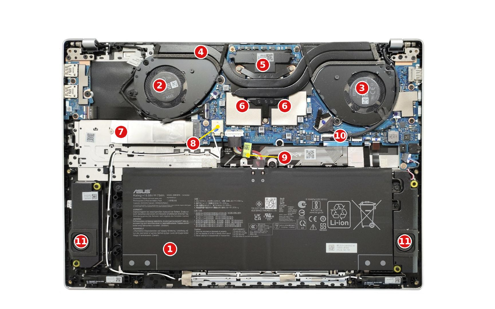

# Lab 3 — Teardown, and the same machine from the command line

Pair: Azat Zhansaya                     Driver first half: Azat Zhansaya
Machine: ASUS Vivobook S 16 (M5606KA), AMD Ryzen AI 5 340, 16 GB LPDDR5X, 512 GB NVMe SSD
Date: 30.10.2026

## What I did

### Part A — the real machine (Windows host, not the VM)

1. Started a transcript and identified the exact model.

```powershell
Start-Transcript -Path windows-specs.txt
Get-CimInstance Win32_ComputerSystem | Format-List *
```
```
Manufacturer        : ASUSTeK COMPUTER INC.
Model               : ASUS Vivobook S 16 M5606KA_M5606KA
SystemFamily        : ASUS Vivobook S 16
TotalPhysicalMemory : 16234950656
```

```powershell
Get-CimInstance Win32_ComputerSystemProduct | Format-List *
Get-CimInstance Win32_BaseBoard | Format-List *
```
```
Name              : ASUS Vivobook S 16 M5606KA_M5606KA
IdentifyingNumber : XXXX
Product           : M5606KA
SerialNumber      : XXXX
```

2. Looked for a service manual. ASUS does not publish one for this model, so I used
   the ASUS Tech Specs page, the LaptopMedia teardown and the AMD product pages (see Result → Sources).

3. Collected upgrade evidence: memory, disk, CPU.

```powershell
Get-CimInstance Win32_PhysicalMemoryArray | Format-List *
```
```
MemoryDevices : 4
MaxCapacity   : 67108864
```

```powershell
Get-CimInstance Win32_PhysicalMemory | Format-List *
```
```
BankLabel        : A / B / C / D   (four entries)
DeviceLocator    : DIMM 0          (same for all four)
Capacity         : 4294967296      (4 GiB each, 16 GiB total)
FormFactor       : 1               (Other; SO-DIMM would be 12)
SMBIOSMemoryType : 35              (LPDDR5)
Speed            : 8000
PartNumber       : MT62F1G32D2DS-023 WT
```

```powershell
Get-PhysicalDisk | Format-List *
```
```
Model     : HFS512GEM9X174N
MediaType : SSD
BusType   : NVMe
```

```powershell
Get-CimInstance Win32_Processor | Format-List *
Stop-Transcript
```
```
Name                      : AMD Ryzen AI 5 340 w/ Radeon 840M
NumberOfCores             : 6
NumberOfLogicalProcessors : 12
L2CacheSize               : 6144
L3CacheSize               : 16384
MaxClockSpeed             : 2000
SocketDesignation         : FP8LPDDR5x
```

4. Replaced serial numbers and IDs in `windows-specs.txt` with `XXXX`
   (board and system serial, UUID, disk SerialNumber, AdapterSerialNumber, FruId, UniqueId, ObjectId).

5. Numbered the components on the teardown photo in `evidence/manual-figures/components.png`.

### Part B — Linux (VM from Lab 1, VMware Workstation, Ubuntu)

```bash
lscpu > linux-specs.txt
free -h >> linux-specs.txt
sudo dmidecode -t memory >> linux-specs.txt
lsblk -d -o NAME,MODEL,SIZE,ROTA,TRAN >> linux-specs.txt
sudo dmidecode -t baseboard >> linux-specs.txt
```

The full file is long, so I filtered the lines I need:

```bash
grep -E "Model name|^CPU\(s\)|Core\(s\) per socket|Thread\(s\) per core|Hypervisor vendor|^Mem:" linux-specs.txt
```
```
CPU(s):              2
Model name:          AMD Ryzen AI 5 340 w/ Radeon 840M
Thread(s) per core:  1
Core(s) per socket:  2
Hypervisor vendor:   VMware
Mem:   1.6Gi   465Mi   802Mi   1.2Mi   476Mi   1.1Gi   (total used free shared buff/cache available)
```

```bash
sudo dmidecode -t 17 | grep -E "Size|Type:|Speed|Form Factor" | sort | uniq -c
```
```
      1   Configured Memory Speed: Unknown
    128   Form Factor: DIMM
      1   Size: 2 GB
    127   Size: No Module Installed
      1   Speed: Unknown
     64   Type: DRAM
     64   Type: Other
```

```bash
lsblk -d -o NAME,MODEL,SIZE,ROTA,TRAN
```
```
NAME  MODEL                           SIZE  ROTA  TRAN
sda   VMware Virtual S                 25G     1  spi
sr0   VMware Virtual SATA CDRW Drive  2.7G     1  sata
```
(loop devices removed)

```bash
sudo dmidecode -t baseboard | grep -E "Manufacturer|Product Name"
```
```
Manufacturer: Intel Corporation
Product Name: 440BX Desktop Reference Platform
```

## Result

### 1. The machine

ASUS Vivobook S 16, model **M5606KA**. Confirmed by two independent fields:
`Win32_ComputerSystem.Model = ASUS Vivobook S 16 M5606KA_M5606KA` and
`Win32_BaseBoard.Product = M5606KA`.

Sources (no official service manual exists for this model):

- [1] ASUS Tech Specs, Vivobook S 16 (M5606):
  https://www.asus.com/laptops/for-home/vivobook/asus-vivobook-s-16-oled-m5606/techspec/
- [2] LaptopMedia, How to open ASUS Vivobook S 16 OLED M5606 – disassembly and upgrade options:
  https://laptopmedia.com/guides/how-to-open-asus-vivobook-s-16-oled-m5606-disassembly-and-upgrade-options/
- [3] AMD Ryzen AI 5 340 product page:
  https://www.amd.com/en/products/processors/laptop/ryzen/ai-300-series/amd-ryzen-ai-5-340.html
- [4] AMD XAPP1377, Embedded x86 BGA Packages (FPx, FLx, SPx):
  https://docs.amd.com/r/en-US/xapp1377-heatsinks-thermal/Embedded-x86-BGA-Packages-Ryzen-and-EPYC-Covers-FPx-FLx-and-SPx

There are no page numbers in these sources, so I cite the section name instead.

### 2. Components



Photo from [2] (same M5606 chassis; their unit has a different CPU).

1. **Battery**
   - What: Li-ion battery pack, 75 Wh, 15.56 V, model C41N2304 (label on photo).
   - Connects to: motherboard (10) through the battery connector (9).
   - Limits: held by 3 Phillips screws; replace only with the same model C41N2304 ([2], "Battery Removal").

2. **Left fan** and 3. **Right fan**
   - What: two blower fans of the cooling system.
   - Connects to: fan connectors on the motherboard (10); push air through the heat sinks at the ends of the heat pipes (4).
   - Limits: not upgradeable, only cleaning; the bottom panel has a dust filter ([2], "Opening the Device", "Cooling System Overview").

4. **Heat pipes**
   - What: two heat pipes with heat sinks and a heat spreader.
   - Connects to: the cold plate on the CPU (5) and the heat sinks next to both fans (2, 3).
   - Limits: fixed part of the cooling system; only thermal paste can be renewed ([2], "Cooling System Overview").

5. **CPU (under the cold plate)**
   - What: AMD Ryzen AI 5 340, 6 cores / 12 threads, TDP 28 W (configurable 15–54 W) ([3]).
   - Connects to: soldered to the motherboard (10); works with memory (6) and the SSD (7) over PCIe 4.0.
   - Limits: FP8 package ([3], "Socket: FP8"), and FPx packages are BGA ([4]); soldered, cannot be replaced.

6. **Memory (soldered)**
   - What: 16 GB LPDDR5X, dual-channel, under foil and the heat spreader ([1] "Memory", [2] "Memory Information").
   - Connects to: soldered on the motherboard (10) next to the CPU (5).
   - Limits: no SO-DIMM slots, max 16 GB ([1]); cannot be upgraded.

7. **SSD**
   - What: M.2 2280 NVMe SSD, 512 GB (HFS512GEM9X174N), under a metal cover.
   - Connects to: the only M.2 slot on the motherboard (10), PCIe 4.0 x4.
   - Limits: one slot only, M.2 2280, single-sided SSD only ([1] "Storage", [2] "Storage Upgrade").

8. **Wi-Fi (soldered)**
   - What: wireless chip for Wi-Fi and Bluetooth.
   - Connects to: motherboard (10); white antenna cables go to the antennas in the display.
   - Limits: soldered, cannot be replaced ([2], "Memory Information").

9. **Battery connector**
   - What: cable and plug from the battery to the board.
   - Connects to: battery (1) and motherboard (10).
   - Limits: must be disconnected first before any work inside ([2], "Battery Removal").

10. **Motherboard**
    - What: main board, marking DA0ZJ3MBAD0 REV:D, MODEL: ZJ3 (photo); Windows reports Product = M5606KA.
    - Connects to: everything. CPU, memory and Wi-Fi are soldered on it; SSD, battery, fans, speakers and the display cable plug into it.
    - Limits: if the CPU or memory fails, the whole board must be replaced.

11. **Speakers**
    - What: two stereo speakers in the bottom corners.
    - Connects to: motherboard (10) through thin cables.
    - Limits: not upgradeable, replace only with the same part.

### 3. Upgrade verdict

| Component | Manual says | OS says | Verdict |
|---|---|---|---|
| Memory | 16 GB LPDDR5X on board, max 16 GB ([1] "Memory"); soldered under the heat spreader ([2] "Memory Information") | MemoryDevices = 4 (4 × 4 GiB), FormFactor = 1 (not 12), SMBIOSMemoryType = 35 (LPDDR5), MaxCapacity = 64 GB | **No**: soldered |
| Storage | 1x M.2 2280 PCIe 4.0 x4, single-sided SSD only ([1] "Storage"); one M.2 slot ([2] "Storage Upgrade") | BusType = NVMe, MediaType = SSD, HFS512GEM9X174N, 512 GB | **Yes**: replace with a single-sided M.2 2280 NVMe SSD |
| CPU | Ryzen AI 5 340, Socket FP8 ([3]); FPx packages are BGA ([4]) | Name = AMD Ryzen AI 5 340, SocketDesignation = FP8LPDDR5x | **No**: BGA, soldered to the board |

**Manual vs OS disagreement (memory).** The firmware reports MaxCapacity = 64 GB (67108864 KB),
but ASUS Tech Specs for M5606KA give a maximum of 16 GB, which equals the installed on-board LPDDR5X.
I trust the manufacturer. The memory is soldered: FormFactor is 1, not 12 (SO-DIMM), and the four
"DIMM 0" devices with BankLabel A–D are memory chips on four channels, not four slots.
MaxCapacity is a generic field that describes what the memory controller could address,
not what this board has; Windows only repeats what the firmware says.

### 4. Comparison table: Windows vs Linux (VM)

| | Windows (host) | Linux (VM) |
|---|---|---|
| CPU model | `Win32_Processor` → Name = AMD Ryzen AI 5 340 w/ Radeon 840M | `lscpu` → Model name = AMD Ryzen AI 5 340 w/ Radeon 840M |
| Cores | `Win32_Processor` → NumberOfCores = 6 | `lscpu` → Core(s) per socket = 2 |
| Logical CPUs | `Win32_Processor` → NumberOfLogicalProcessors = 12 | `lscpu` → CPU(s) = 2 (Thread(s) per core = 1) |
| Total memory | `Win32_ComputerSystem` → TotalPhysicalMemory = 16234950656 B (≈ 15.1 GiB usable of 16 GB) | `free -h` → Mem total = 1.6Gi; `dmidecode -t memory` → Size = 2 GB |
| Memory type / speed | `Win32_PhysicalMemory` → SMBIOSMemoryType = 35 (LPDDR5), Speed = 8000 | `dmidecode -t memory` → Type = DRAM / Other, Speed = Unknown, Form Factor = DIMM (128 slots, 1 used) |
| Disk type | `Get-PhysicalDisk` → MediaType = SSD | `lsblk` → ROTA = 1 (rotational, looks like an HDD) |
| Disk interface | `Get-PhysicalDisk` → BusType = NVMe | `lsblk` → TRAN = spi (SCSI), MODEL = VMware Virtual S |
| Motherboard | `Win32_BaseBoard` → Product = M5606KA (ASUSTeK) | `dmidecode -t baseboard` → Intel Corporation, 440BX Desktop Reference Platform |

The field names differ the most for the same idea: `NumberOfLogicalProcessors` vs `CPU(s)`,
`BusType` vs `TRAN`, `MediaType = SSD` vs `ROTA = 1`, and Windows gives memory type as a number
(35) while dmidecode gives text. Only the CPU model is the same in both columns; everything else in
the VM is virtual hardware: 2 vCPUs, 2 GB RAM in 1 of 128 fake DIMM slots, a 25 GB "rotating" SCSI disk
and an old Intel 440BX board, because VMware shows the guest what it emulates, not the real laptop
(`lscpu` also says Hypervisor vendor = VMware). Also, Windows `MaxClockSpeed = 2000` is the base clock,
not the real maximum (AMD lists boost up to 4.8 GHz [3]).

## What did not work the first time

1. **Transcript was missing the model.** After the memory, disk and CPU commands I noticed that
   `windows-specs.txt` did not contain `Win32_ComputerSystem`. It turned out I had not run it inside
   this transcript. I ran `Win32_ComputerSystem` and `Win32_ComputerSystemProduct` again before
   `Stop-Transcript`, so the model is now in the evidence file.
2. **Four memory devices looked like four slots.** `MemoryDevices = 4` and `MaxCapacity = 64 GB` made it
   look like the RAM could be upgraded. It turned out all four have `DeviceLocator = DIMM 0` and
   `FormFactor = 1`, so they are soldered chips on four channels. ASUS Tech Specs confirm max 16 GB,
   so the verdict is "No".
3. **The memory filter printed nothing in the VM.** My first command
   `sudo dmidecode -t memory | grep -E "^\s+(Size|Type|Speed|Form Factor):"` returned no lines.
   I simplified it to `sudo dmidecode -t 17 | grep -E "Size|Type:|Speed|Form Factor" | sort | uniq -c`,
   which worked and also showed that the VM reports 128 DIMM slots with only one 2 GB module.

## Evidence

- [evidence/windows-specs.txt](evidence/windows-specs.txt) — PowerShell transcript from the real machine: model, memory, disk, CPU (serials replaced with XXXX)
- [evidence/linux-specs.txt](evidence/linux-specs.txt) — lscpu, free, dmidecode, lsblk output from the Ubuntu VM (proves the VM sees different, virtual hardware)
- [evidence/manual-figures/components.png](evidence/manual-figures/components.png) — teardown photo with numbered components
