# How to build a test machine (Linux + Windows)

For: Aigerim T. · Written by: Azat Zhansaya · 02.11.2026
Tested on: Windows laptop, 16 GB RAM, VMware Workstation Pro 26H1

This guide creates two virtual machines on one computer: a Linux machine
and a Windows machine. A virtual machine is a computer that runs inside a
window on your computer. Whatever the developer does inside it cannot
damage your real files, and with snapshots (Steps 14, 21, 24) any mistake
can be undone in one minute.

## Before you start

You need:

- A Windows computer with **16 GB of memory** and **at least 100 GB free**
  on drive C: (This PC → drive C:).
- **Virtualization turned on.** Press Ctrl+Shift+Esc → Performance → CPU.
  "Virtualization" must say **Enabled**. If it says Disabled, ask IT to turn
  on Intel VT-x / AMD-V in the BIOS.
- **VMware Workstation Pro** from the Broadcom website (needs a free Broadcom
  account). Install with the default settings.
- **Ubuntu Server 26.04.1 LTS**: the file `ubuntu-26.04.1-live-server-amd64.iso`
  from ubuntu.com/download/server.
- **Windows 11 Enterprise Evaluation**: the ISO file from microsoft.com/evalcenter.
- About 2 hours.

Keep a text file open for **usernames, passwords and addresses**. You will
need them later, and one of them (Step 17) cannot be recovered if lost.

**Close all other programs** (browser, Teams, Telegram) before starting the
machines. Together they need 6 GB of memory. On my 16 GB laptop only 3.0 GB
was free with my usual programs open, and 7.1 GB after closing them.

---

## Part A. The Linux machine

### Step 1. Start the wizard

In VMware: **File → New Virtual Machine** → **Typical** → Next.

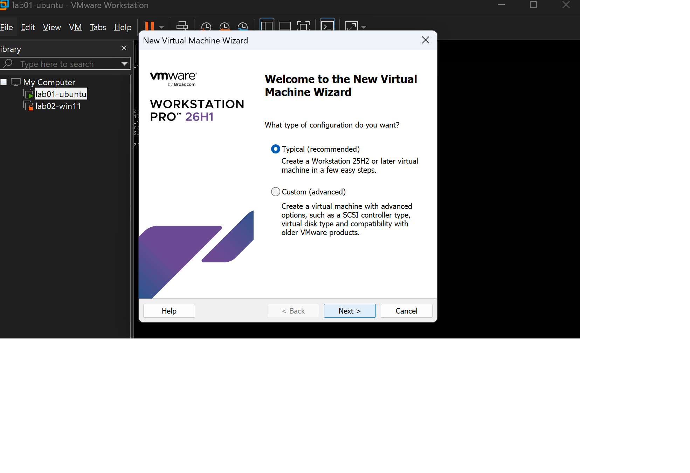

Why: Typical asks the fewest questions. Memory and network are changed in Step 6.

### Step 2. Choose the installation file

**Installer disc image file (iso)** → Browse → the Ubuntu file → Next.
If VMware says it cannot detect the operating system, that is normal.

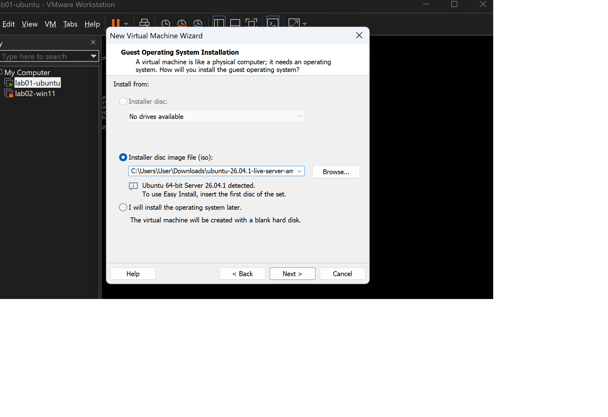

### Step 3. System type

**Linux**, version **Ubuntu 64-bit** → Next.

Why: VMware chooses suitable default settings for the system you name here.

### Step 4. Name

Name: `ticket1-ubuntu`. Leave the location as it is → Next.

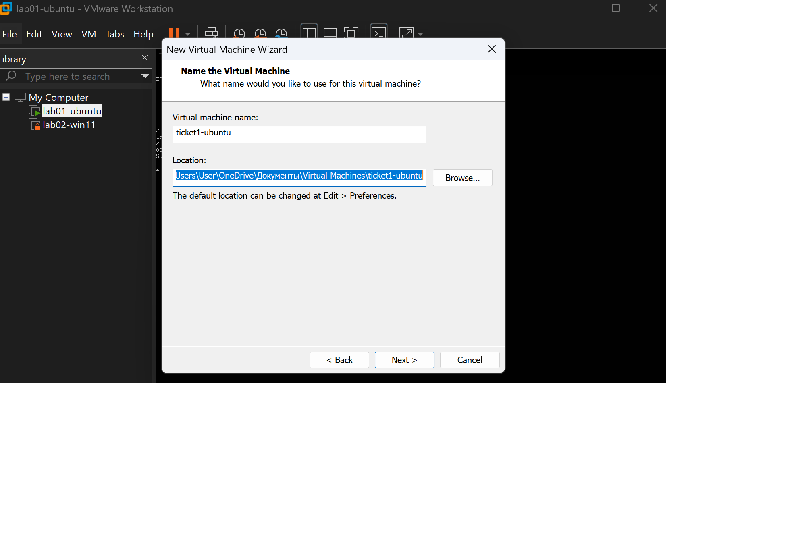

### Step 5. Disk

Maximum disk size: **25** GB. Choose **Store virtual disk as a single file** → Next.

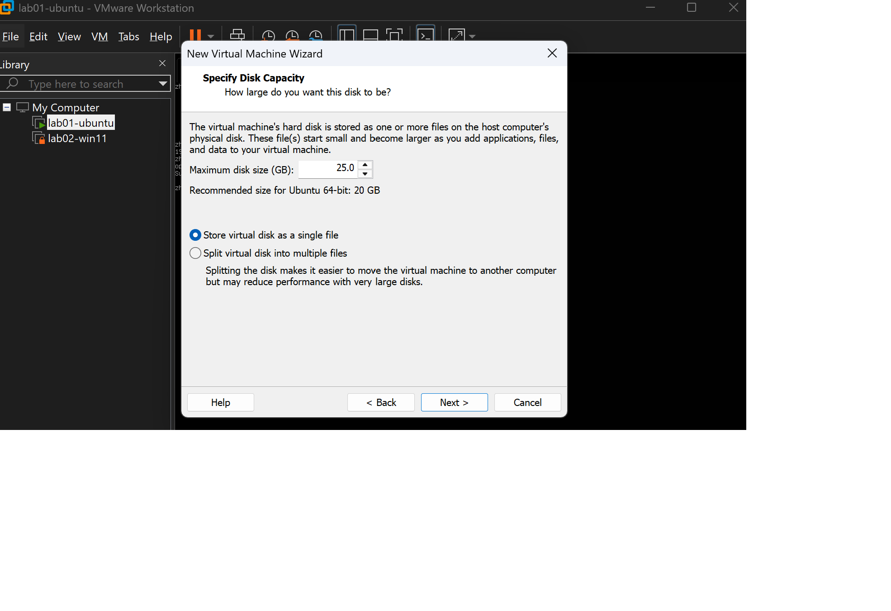

Why: one file is easier to copy and move; splitting is only for old drives
that cannot hold large files. The file does not take 25 GB at once: it grows
as Linux writes data (about 5 GB after installation).

### Step 6. Memory, processors, network

Click **Customize Hardware**:

- **Memory: 2048 MB.** VMware suggests more: change it.
- **Processors: 2** (2 processors × 1 core). Leave every box under
  "Virtualization engine" unticked.

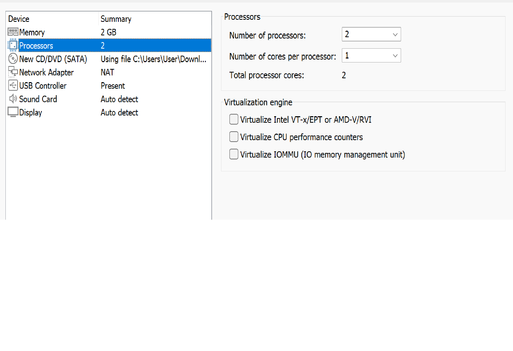

- **Network Adapter: NAT.**

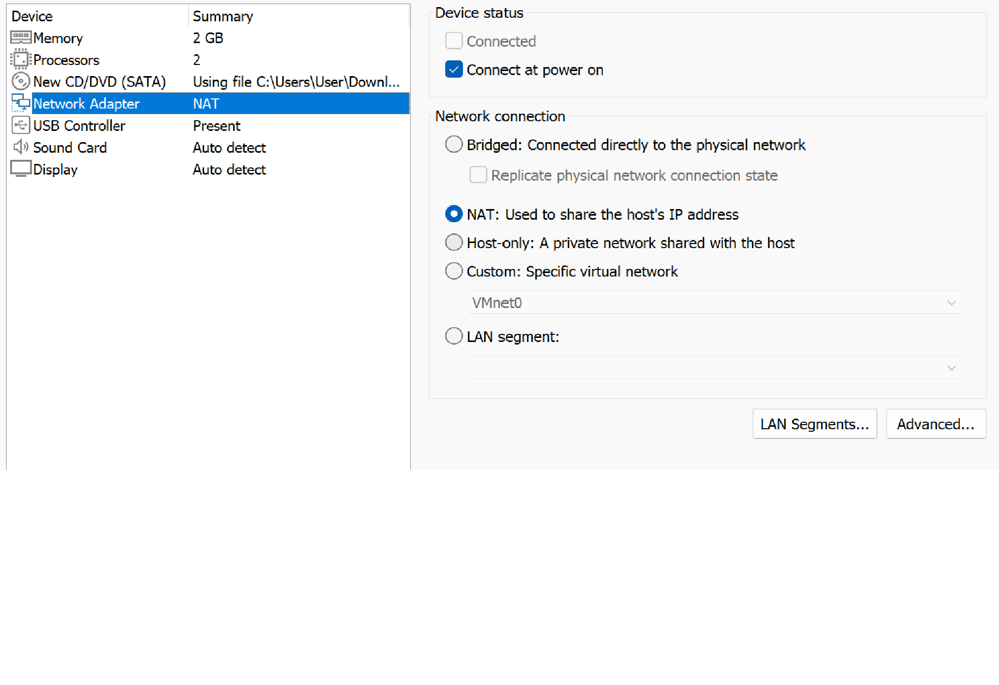

Why 2048 MB: this Linux needs about 2 GB and Windows needs 4 GB more. Giving
more makes your own computer slow.
Why NAT: the machine reaches the internet through your computer and can see
the Windows machine. "Bridged" can be blocked by the office network, and
"Host-only" has no internet.

**Close → Finish.** The machine starts.

### Step 7. Start the installer

Choose **Try or Install Ubuntu Server** → Enter.
The mouse does not work here: use the **arrow keys**, **Space** to tick a
box, **Enter** to confirm.

Language: **English**. If it offers to update the installer:
**Continue without updating**. Keyboard: English (US) → Done.

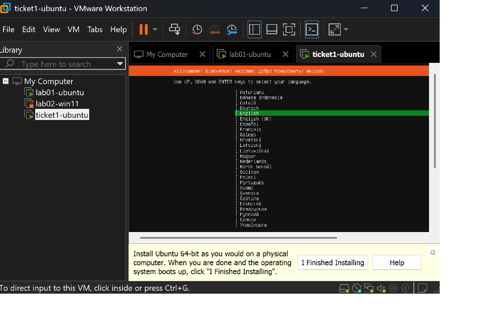

Why English: English error messages are much easier to search for online.

### Step 8. Installation type

**Ubuntu Server** (not "minimized") → Done.

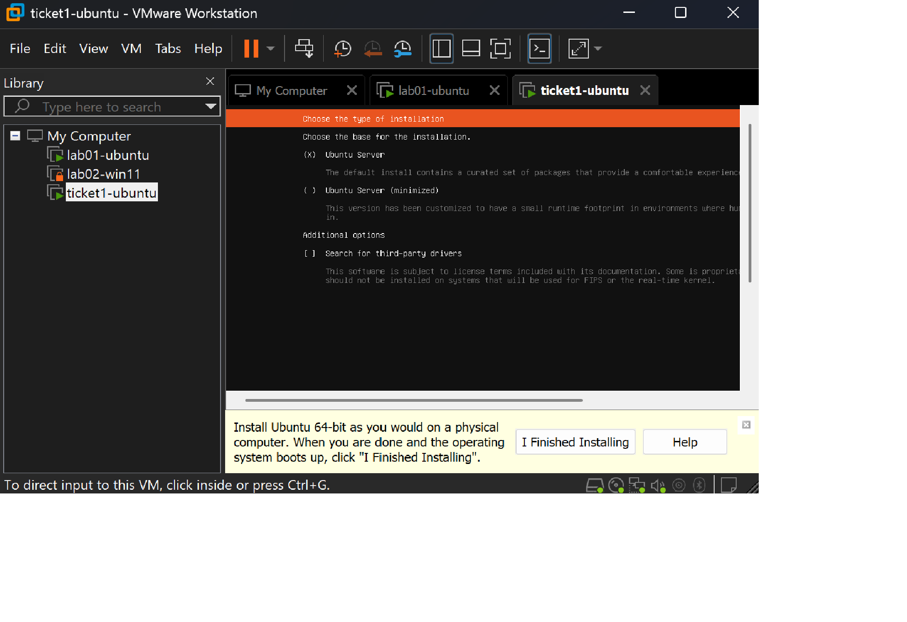

### Step 9. Network

Next to `ens33` an address like `192.168.100.133/24` appears.
**Write down the part before `/`** (mine was `192.168.100.133`) → Done.

> Check: if there is no address, go back to Step 6, the adapter must be NAT.

Proxy: leave empty → Done. Mirror: wait for the check to finish → Done.

### Step 10. Disk layout

**Use an entire disk**, then **untick** "Set up this disk as an LVM group"
→ Done → Done → **Continue**.

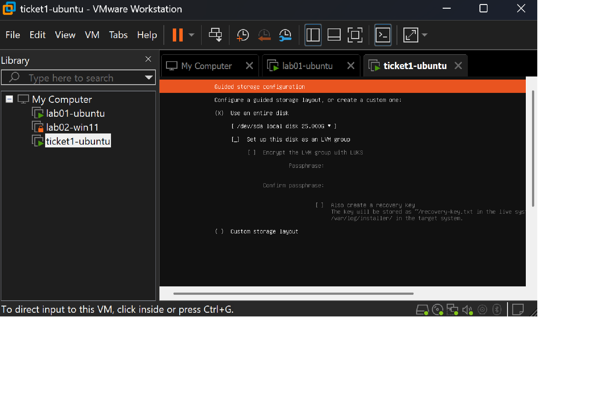

Don't be scared by "erase disk": it is the 25 GB virtual disk from Step 5.
Your real computer is not touched.
Why untick LVM: otherwise Linux gets only about half of the 25 GB.

### Step 11. User

Your name, server name `ticket1-ubuntu`, username, password.
**Write down the username and password** → Done.
Ubuntu Pro: **Skip for now** → Continue.

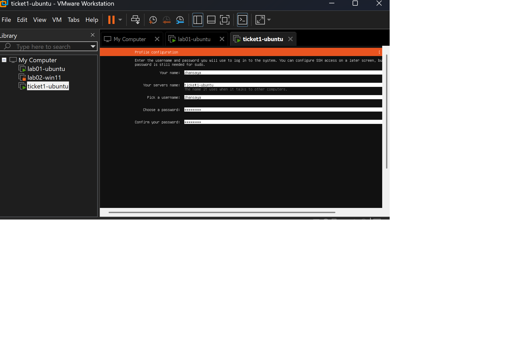

### Step 12. Remote access

Tick **Install OpenSSH server** (Space). Leave "Allow password
authentication" ticked. Don't import a key → Done.
Featured snaps: tick nothing → Done.

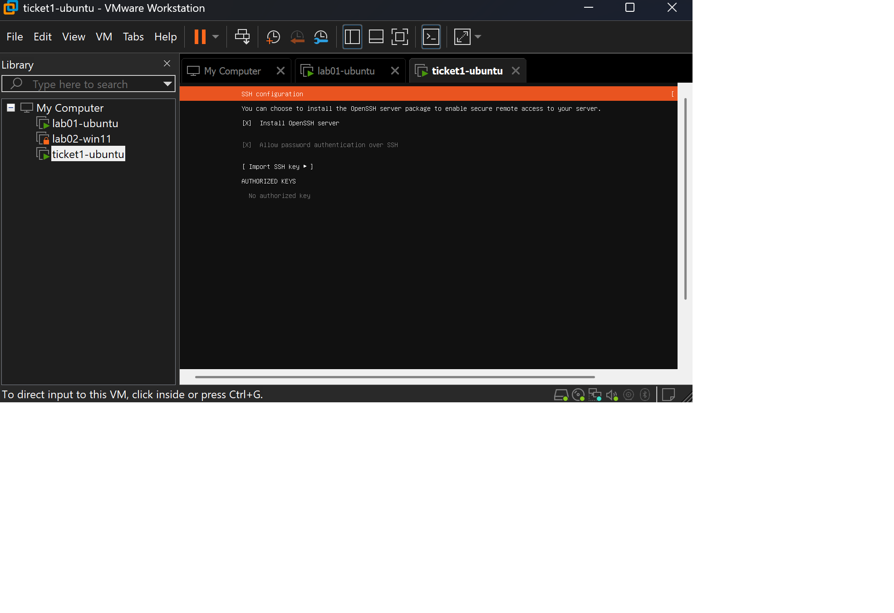

Why: you can connect to this machine from your own computer and copy
results as text.

### Step 13. Finish and update

Wait for **Reboot Now** → Enter (if asked to remove the installation medium,
press Enter again). Log in and type:

```
sudo apt update && sudo apt upgrade -y
ip a
```

> Check: `ip a` shows the same address as in Step 9.
> If `apt update` cannot reach the internet, see "Linux has no internet" at the end.

### Step 14. Snapshot

Type `sudo poweroff`. Then **VM → Snapshot → Take Snapshot**, name `clean-install`.

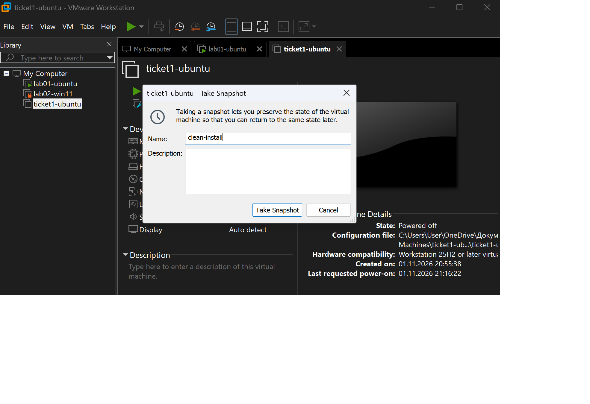

Why: this is the "undo" button. **VM → Snapshot → Revert to Snapshot**
returns the machine exactly to this moment.

---

## Part B. The Windows machine

### Step 15. Start the wizard

**File → New Virtual Machine → Typical** → the Windows 11 ISO → Next.

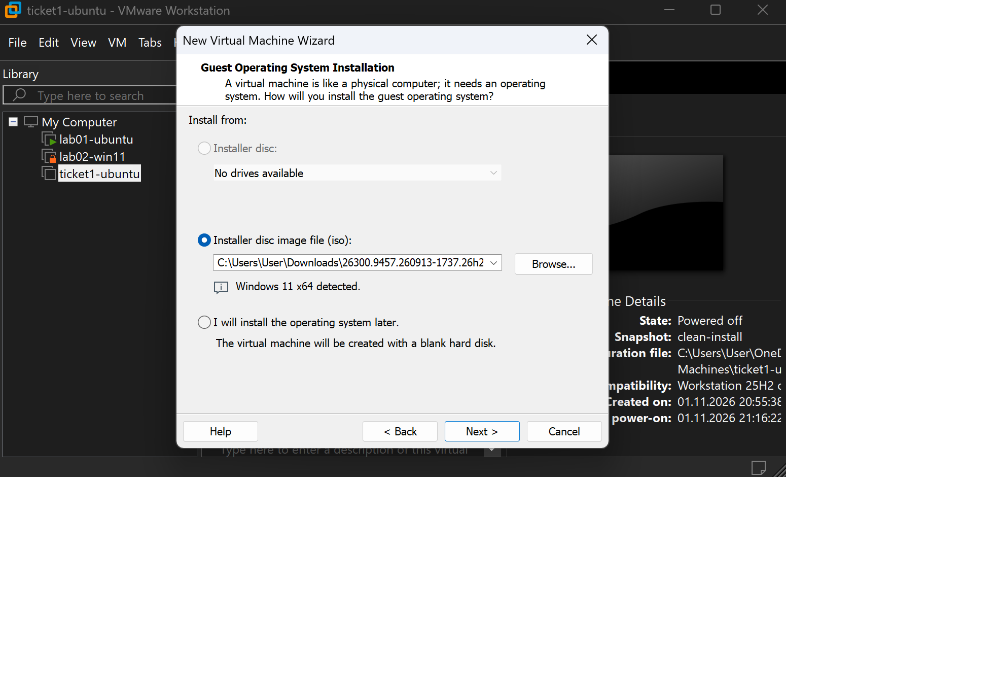

### Step 16. Easy Install and name

VMware shows **Easy Install Information**. Enter a full name and a password.
**Write them down.** Next.


Name the machine `ticket1-win11` → Next.

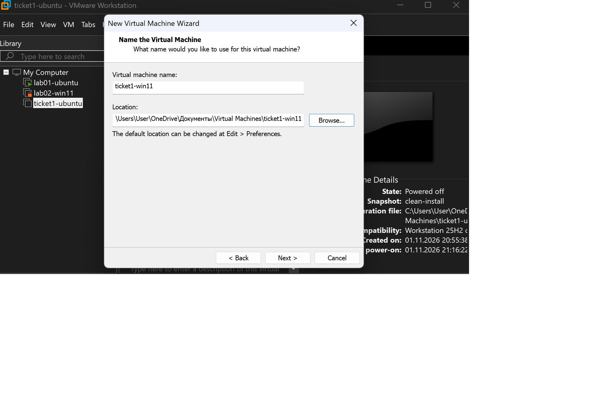

Why: with Easy Install VMware creates a local account (no Microsoft or work
account needed) and installs VMware Tools by itself.

### Step 17. Encryption

Choose **Only the files needed to support a TPM are encrypted** and enter a
password. **Write it down: without it this machine can never be opened again.**

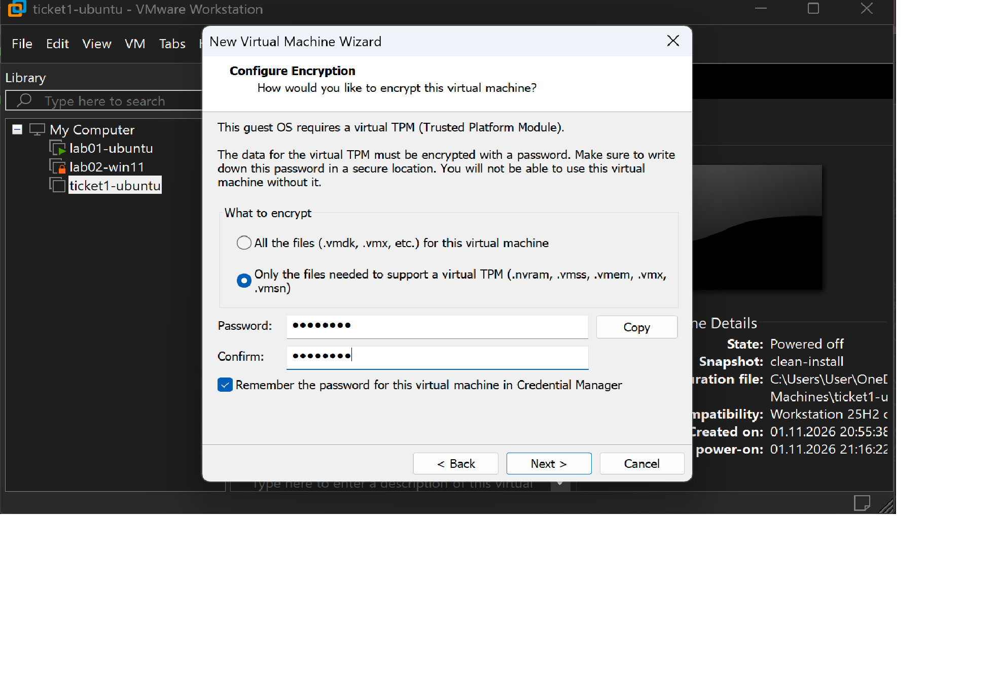

Why: Windows 11 requires a security chip (TPM). VMware creates a virtual one
and keeps it encrypted.

### Step 18. Disk

**64** GB, **Store virtual disk as a single file** → Next.

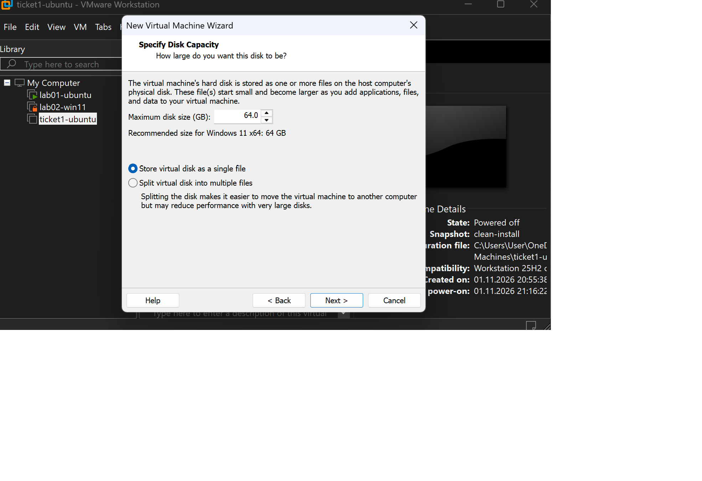

Why 64: Windows 11 refuses to install on a smaller disk.

### Step 19. Memory, processors, network

**Customize Hardware**: Memory **4096 MB**, Processors **2**, Network
Adapter **NAT** → Close → Finish.

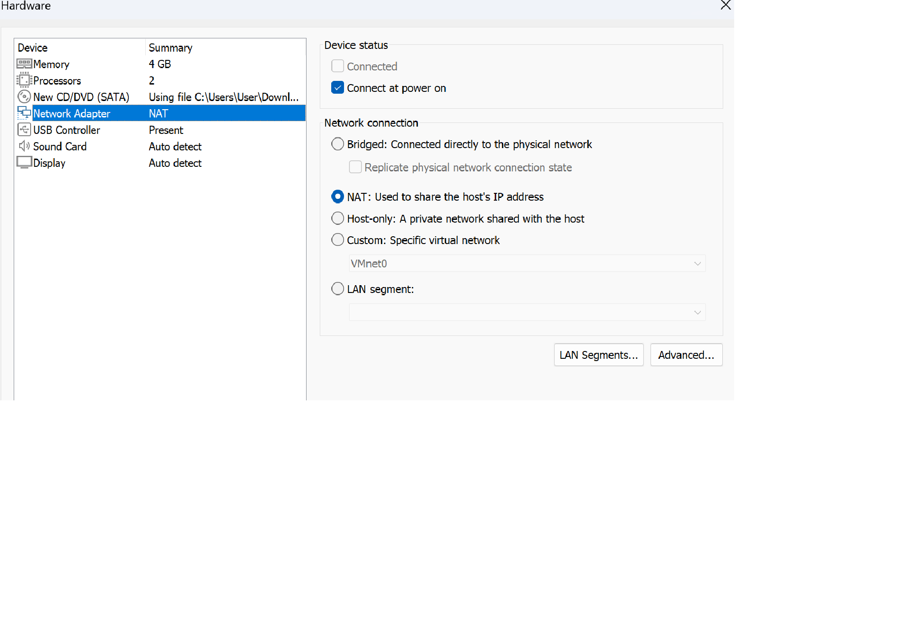

Why 4096 MB: the minimum Windows 11 accepts. NAT: the same network as Linux.

### Step 20. Choose the disk and wait

Windows Setup starts. When it shows **Select location to install Windows 11**,
choose **Disk 0 Unallocated Space** → Next.

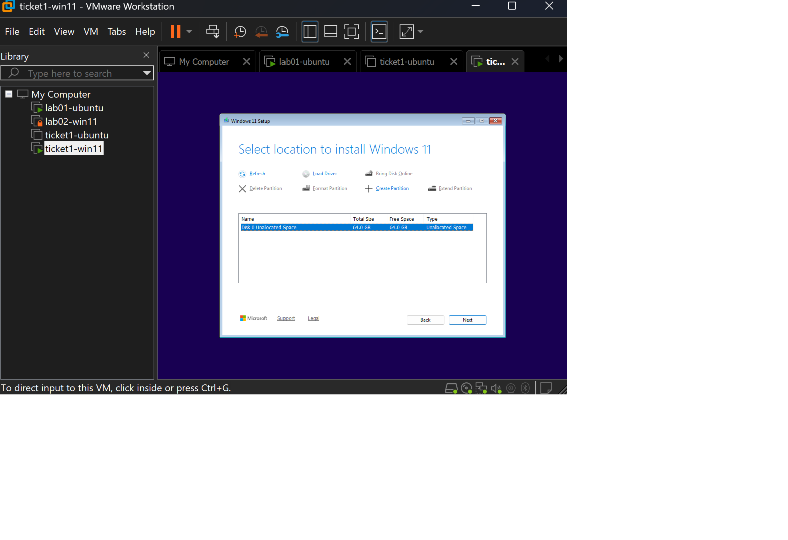

Don't worry: Disk 0 is the 64 GB virtual disk from Step 18, not your real disk.

After that Windows installs and restarts several times by itself (about
20–30 minutes). Do not press anything until you see the Windows desktop —
it logs in by itself.

> Check: Settings → Accounts → Your info says **Local account**.

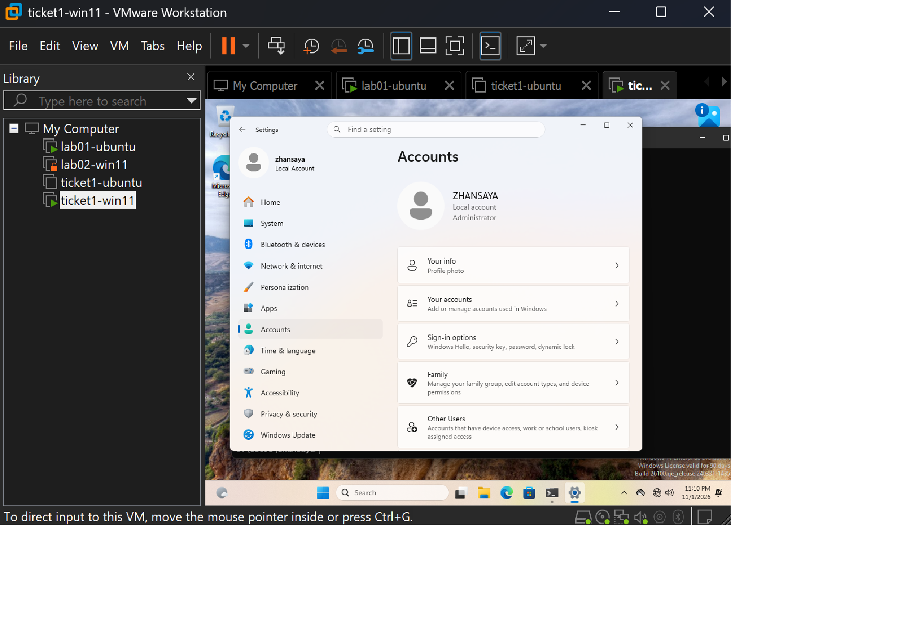

Write down the Windows address: Start → `cmd` → `ipconfig` → "IPv4 Address"
(mine was `192.168.100.135`).

### Step 21. Snapshot

Shut down Windows. **VM → Snapshot → Take Snapshot** → `clean-install`.

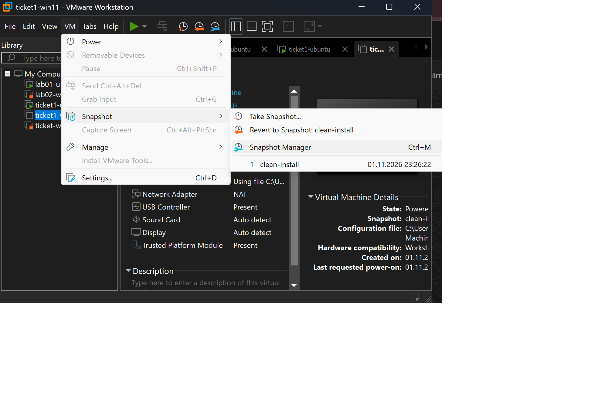

---

## Part C. Connect the machines

### Step 22. Allow ping in Windows

Windows blocks "ping" from other computers by default. In Windows: Start →
type `PowerShell` → right-click → **Run as administrator** → paste:

```
New-NetFirewallRule -DisplayName "Ticket1 - allow ping (ICMPv4 echo)" -Direction Inbound -Protocol ICMPv4 -IcmpType 8 -RemoteAddress LocalSubnet -Action Allow
```

Why only this rule: it allows ping, and only from the local network.
Switching the whole firewall off would be much less safe.

### Step 23. Check

Start both machines. Use your own addresses from Steps 9 and 20.

In Linux:

```
ping -c 4 192.168.100.135
ping -c 4 8.8.8.8
ping -c 4 google.com
```

In Windows (Start → cmd):

```
ping 192.168.100.133
ping google.com
```

> Check: every command shows `0% packet loss` (Linux) or `Lost = 0` (Windows).
> If not, see "If something goes wrong" below.

### Step 24. Final snapshot

Shut down both machines and take a snapshot `network-ok` on each.
**VM → Snapshot → Snapshot Manager** shows both snapshots.

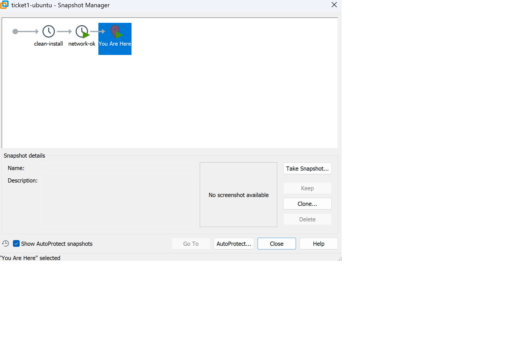

The machines are ready for the developer.

---

## Before you hand it over

- **Windows works for 90 days.** This is an Evaluation version. After that
  it starts shutting itself down. For a permanent machine the company has
  to buy a Windows licence. To see how many days are left: in cmd,
  `slmgr /dlv` → "Timebased activation expiration".
- **Teach the developer one thing:** if he breaks something,
  **VM → Snapshot → Revert to Snapshot → network-ok**.

---

## If something goes wrong

| Problem | What to do |
|---|---|
| Everything is very slow | Close other programs. The two machines need 6 GB of memory. |
| "Virtualization: Disabled" | Ask IT to enable Intel VT-x / AMD-V in the BIOS. |
| Linux has no address in Step 9 | Network Adapter must be NAT (Step 6). |
| Linux → Windows ping: 100% packet loss | Step 22 not done, or PowerShell was not "Run as administrator". |
| Machines see each other, but Linux has no internet (`ping 8.8.8.8` fails) | See "Linux has no internet" below. |
| The developer broke something | VM → Snapshot → Revert to Snapshot → `network-ok`. |
| Lost the encryption password (Step 17) | The Windows machine cannot be opened. Delete it and repeat Part B. |

### Linux has no internet

The VMware NAT service on your computer has hung. On your computer (not in
the virtual machine), open PowerShell **as administrator**:

```
Restart-Service "VMware NAT Service"
Get-Service "VMware NAT Service"
```

If the status is not **Running**, stop the hung process and start the
service again (repeat once more if needed):

```
Stop-Process -Name vmnat -Force
Start-Service "VMware NAT Service"
Get-Service "VMware NAT Service"
```

Then in Linux:

```
sudo ip neigh flush all
ping -c 4 8.8.8.8
```

> Check: `0% packet loss`.